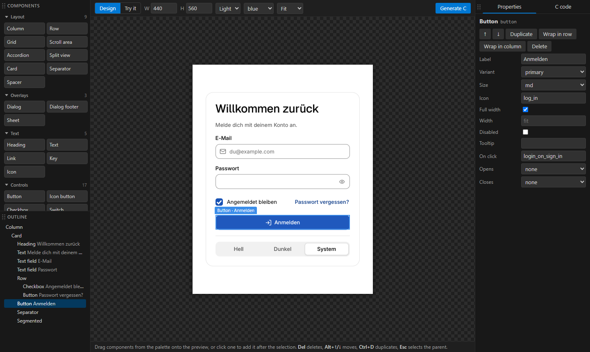
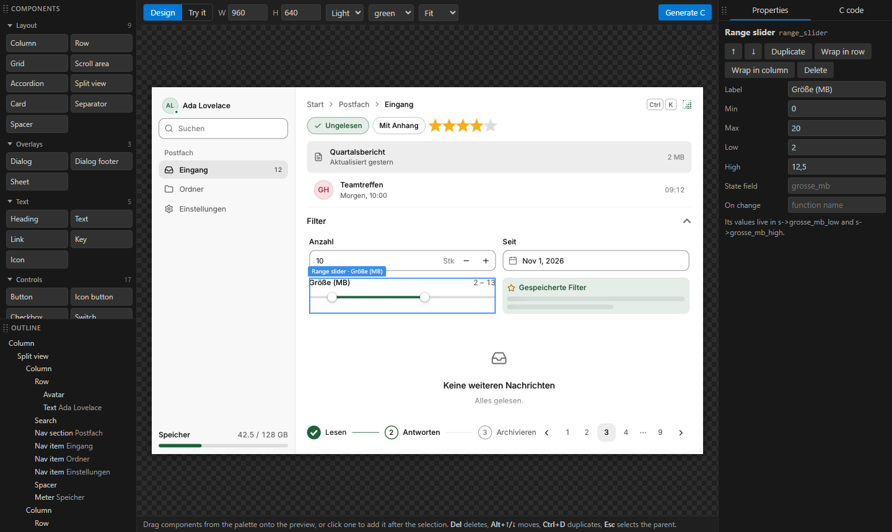
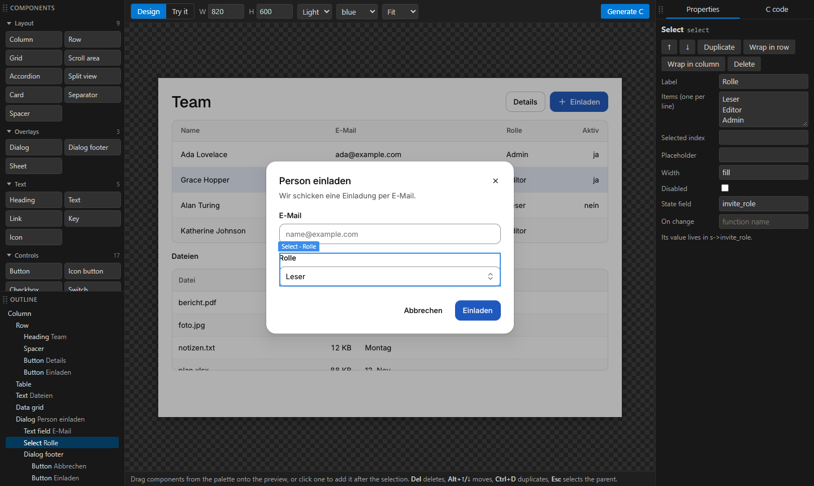

# CUI Designer for VS Code (prototype)

Put a CUI interface together with the mouse and get the C code that builds it.
A design is a `*.cui.json` file. VS Code opens it in the designer, and saving
it writes `<name>.ui.h` and `<name>.ui.c` next to it.

This is an experimental prototype. It covers the layout containers and the most
common components, not all of CUI.



## What it does

- **Palette**: 50 kinds in eight groups. A click on a group's heading folds it. Drag a component onto the preview, or click it to add it after the selection.
- **Panels**: the palette, the outline and the properties sit in columns beside the preview. Drag the lines between them to change widths and heights (a double-click on a column's line gives its default width). Drag a panel by its header (the dots, for the properties) to another place in a column, to a column's edge for a new column there, or to the outer quarter of the preview for a new column on that side. VS Code keeps the layout and the folded groups for every design.
  - *Layout*: column, row and grid (with a theme background, border and radius), scroll area, accordion, split view (the first child is the first pane), card, separator, spacer.
  - *Overlays*: dialog, dialog footer (the dialog's button row) and sheet. A dialog shows in the designer while it or something in it is selected; in *Try it* and in the app it opens when its state field is true. A button, icon button or link opens or closes one with its *Opens* and *Closes* properties.
  - *Text*: heading, text, link, key cap, icon.
  - *Controls*: button, icon button, checkbox, switch, slider, text field, text area, select, segmented control, tabs, radio group, search, number field, chip, rating, range slider, date picker.
  - *Navigation*: nav section, nav item, breadcrumb, pagination, stepper.
  - *Data*: table and data grid (the grid builds only its visible rows). Columns are lines like `Size, 90, right` (a title, then a width and an alignment); rows are lines of cells between `|`. With *Data* set to *code*, the generated header declares two functions that give the rows, and the preview keeps showing the sample rows.
  - *Feedback*: progress, badge, alert, spinner, skeleton, empty state.
  - *Display*: avatar, list item, meter.
- **Preview**: the real library compiled to WebAssembly and drawn by its software renderer. *Fit* zooms a large design out to the editor's size; the other zoom levels are fixed. It is not an imitation: what you see is what the generated code draws (see [Checks](#checks)). In **Design** mode you select, drag and move. In **Try it** mode the preview takes the mouse and keyboard like the app, and the status line names the event handler that a click or change would call.
- **Outline** and **properties**: every option from the component's options struct, edited in place. <kbd>Del</kbd> deletes, <kbd>Alt+↑/↓</kbd> moves, <kbd>Ctrl+D</kbd> duplicates, <kbd>Esc</kbd> selects the parent. *Wrap in row* and *Wrap in column* put a container around the selection.
- **Undo, redo, save** come from VS Code: the designer edits the JSON text. *Reopen Editor With… → Text Editor* shows the JSON itself.
- **C code**: the *C code* tab shows it live, *Generate C* (or saving, or *CUI: Generate C Code*) writes it to disk.





The images show the webview in a browser (`test/serve.js`), where it looks as it does in VS Code's dark theme.

## The generated code

For `login.cui.json` with the C prefix `login`:

```c
/* login.ui.h */
typedef struct login_ui {         /* one field per control that keeps a value */
    char email[256];
    bool remember;
    int theme;
} login_ui;
void login_on_sign_in(cui_ctx *ui, login_ui *s);   /* the event handlers you named: you write them */
void login_ui_init(login_ui *s);                   /* the values set in the designer */
void login_ui_build(cui_ctx *ui, login_ui *s);     /* call it every frame */
```

```c
/* your code */
#include "login.ui.h"

void login_on_sign_in(cui_ctx *ui, login_ui *s) { (void)ui; printf("sign in as %s\n", s->email); }

static void frame(cui_ctx *ui, void *user) { login_ui_build(ui, user); }

int main(void) {
    static login_ui s;
    login_ui_init(&s);
    return cui_app_run(&(cui_app_desc){ .title = "Login", .width = 440, .height = 560 }, frame, &s);
}
```

A control's state field is its *State field* property, or a name made from its
label. An event handler is called when its *On click*, *On change* or
*On Enter* property names a function. A dialog's state field says whether it is
open; a button with *Opens* sets it. A table's state field is its selected row
(-1 for none). For a table whose *Data* is *code*, the header also declares

```c
int team_file_rows(team_ui *s);                                 /* how many rows */
const char *team_file_cell(team_ui *s, int row, int column);   /* the text of one cell */
```

Do not edit the generated files: the next save overwrites them.

## Build and run

```sh
editors/vscode/build.sh          # media/designer.wasm, needs clang with the wasm32 target and wasm-ld
code --extensionDevelopmentPath="$PWD/editors/vscode" editors/vscode/samples
```

To install it in your own VS Code, package it after `build.sh` and install the file:

```sh
cd editors/vscode && npm run package
code --install-extension cui-designer-0.1.0.vsix
```

`npm run package` calls `vsce` with the GitHub addresses for the README's images,
which `vsce` cannot work out for an extension in a subfolder.

Then open a `*.cui.json` file, or run *CUI: New Design* from the command palette or
the explorer's context menu on a folder. To work on the webview without VS Code,
`node editors/vscode/test/serve.js` serves it at http://localhost:8790/ with a stand-in
for the VS Code API (`?design=samples/settings.cui.json` loads another design).

## How it works

| File | What it is |
|---|---|
| `native/designer.c` | The preview's interpreter: the webview sends the tree in (`dsg_add`, `dsg_set`) and it builds it with the real components every frame, and reports each node's rectangle for selection and drop targets. Linked with `web/host/web_host.c`, like the documentation site's modules. |
| `media/components.js` | The components, their properties and the C option each property sets. The palette, the property panel and the code generator read it. |
| `media/codegen.js` | The C generator. It runs in the extension (on save) and in the webview (the *C code* tab). |
| `media/designer.js` | The webview: palette, outline, overlay, drag and drop, property panel and input for *Try it*. |
| `media/layout.js` | The panels' columns: the splitters and moving a panel by its header. |
| `extension.js` | The custom editor for `*.cui.json`, the commands, and writing the C files on save. |

`native/designer.c` and `media/codegen.js` make the same calls with the same
options. A change to one needs the same change to the other, and the fidelity
check below catches a mismatch.

## Checks

```sh
cd editors/vscode
node test/codegen.test.js          # the generated C of every sample compiles (clang -Wall -Wextra -Werror)
node test/fidelity.mjs             # every sample's generated C, compiled to wasm, draws byte for byte what the preview draws
node test/extension.test.js        # the extension against a stand-in for the vscode API
node test/smoke.mjs                # the preview module builds a tree and reports rectangles
```

## Not done yet

- Most of CUI's 210 components: trees, tree tables, charts, popovers, menus, toasts, toolbars, color pickers, images and the rest.
- Tables show text only: no components in cells, no sortable headers, no editable cells, and no checkbox selection in the data grid.
- Dynamic text (a label that shows a value from the state), lists built from data, and showing parts of the UI only under a condition.
- Reading hand-written C back into a design. The generator writes in one direction.
- Packaging as a `.vsix` and building in CI.
